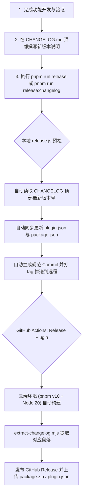

# 自动化发版与 CHANGELOG 维护指南

本文档详细介绍了 **思源邮递员（siyuan-postman）** 插件的自动化发布工作流、版本更新日志（CHANGELOG.md）的写作规范、本地发版脚本的使用方法以及 GitHub Actions 自动化流水线的配置和常见问题排障。

---

## 一、自动化发版工作流概述

本项目作为自动化发布的**试点项目**，配置了基于 **GitHub Actions** 的全自动发版流水线：



### 核心特性
1. **CHANGELOG 驱动版本同步**：只需在 [CHANGELOG.md](../CHANGELOG.md) 顶部撰写新版本（如 `## [v1.0.6] - 2026-10-13`），发版脚本自动将版本号同步到 `plugin.json` 和 `package.json`，无需多处手动修改。
2. **自动提取更新日志**：根据触发的 Tag 标签（如 `v1.0.6`），自动从 [CHANGELOG.md](../CHANGELOG.md) 中切片提取该版本正文，作为 GitHub Release 的 Release Notes。
3. **缺失阻断（Fail-fast）保障**：若未在 `CHANGELOG.md` 中撰写对应版本日志，流水线会主动报错阻断，防止空日志流入生产。
4. **智能预发布识别**：标签中包含 `-alpha`、`-beta`、`-rc` 时自动标识为预发布（Prerelease），常规语义化版本号自动标记为正式 Release。
5. **完整附件上传**：自动打包上传 `package.zip`（供思源集市及用户下载安装）与 `plugin.json`（供元信息探测）。
6. **单一权威包管理器保障**：全面统一切换至 `pnpm`（通过 `pnpm-lock.yaml` 锁定），移除遗留的 `package-lock.json`，并通过 `preinstall` 钩子拦截误用 `npm`。

---

## 二、CHANGELOG.md 写作规范

CHANGELOG 遵循行业标准的 **[Keep a Changelog](https://keepachangelog.com/zh-CN/1.1.0/)** 规范。

### 2.1 标题格式约定

版本更新记录必须使用 **二级 Markdown 标题（`##`）**，且标题包含版本号与发布日期：

```markdown
## [vX.Y.Z] - YYYY-MM-DD
```

- **版本号声明**：推荐书写为 `## [v1.0.6] - 2026-10-13`。
- **日期格式**：统一采用 ISO 8601 格式 `YYYY-MM-DD`。

### 2.2 更新分类标签

每个版本正文推荐使用 **三级标题（`###`）** 对变更条目进行归类：

| 分类标题 | 英文对应 | 适用范围说明 |
| :--- | :--- | :--- |
| `### 新增` | `Added` | 新增发信方式、新配置项或新交互面板 |
| `### 改进` | `Changed` | 现有功能交互优化、界面视觉调整 |
| `### 修复` | `Fixed` | 缺陷修复、邮件发信异常处理 |
| `### 优化` | `Performance` | 渲染性能提升、降低内存占用 |

### 2.3 本地提取测试验证

在推送 Tag 前，可以使用内置脚本在本地快速验证当前版本的 CHANGELOG 能否被正确解析：

```bash
# 验证提取指定版本的更新日志并直接打印在控制台
pnpm run changelog:extract v1.0.6
```

---

## 三、发版操作步骤指南

### 推荐：CHANGELOG 驱动一键发版

#### 第 1 步：在 CHANGELOG.md 中编写即将发布的版本日志
打开 [CHANGELOG.md](../CHANGELOG.md)，在最顶部添加新版本内容，例如：
```markdown
## [v1.0.6] - 2026-10-13

### 改进
- 接入自动化 GitHub Actions 发版与 CHANGELOG 提取工作流；
```

#### 第 2 步：运行发版脚本
```bash
# 推荐方式一：交互式发版（自动读取 CHANGELOG.md 顶部新版本，回车确认即可全自动同步）
pnpm run release

# 推荐方式二：免交互直发模式（严格直接按 CHANGELOG.md 最新版本号发布）：
pnpm run release:changelog

# 传统模式（手动指定递增级别）：
pnpm run release:patch  # 适合 Bug 修复，版本号 +0.0.1
pnpm run release:minor  # 适合特性新增，版本号 +0.1.0
pnpm run release:major  # 适合大版本重构，版本号 +1.0.0
```

脚本将自动执行以下保护与操作：
1. **自动感知与同步版本号**：脚本优先从 `CHANGELOG.md` 顶部解析最新版本号（如 `1.0.6`），回车确认后**自动同步更新 [plugin.json](../plugin.json) 和 [package.json](../package.json) 中的 `version` 字段**。
2. **自动预检 CHANGELOG**：若检测到 `CHANGELOG.md` 中尚未撰写该版本的日志，脚本会立即弹出黄色警告并提示是否取消，防止推送后 CI 报错。
3. **规范提交代码**：自动生成符合项目 Git Commit 规范的提交信息（例如 `chore(release): 升级版本至 v1.0.6`），并将 `plugin.json`、`package.json` 及 `CHANGELOG.md` 一并提交。
4. **创建并推送 Tag**：自动在当前 Commit 上打上 `v1.0.6` 标签并推送到 GitHub 远程仓库（`git push origin v1.0.6`）。

#### 第 3 步：前往 GitHub 确认 Release 结果
Tag 推送后，GitHub Actions 工作流将自动触发。访问仓库的 **Actions** 标签页，几分钟后即可在 **Releases** 页面看到带有完整更新日志和附件的发布版本。

---

## 四、GitHub Actions 自动化流水线配置

配置文件位于 [.github/workflows/release.yml](../.github/workflows/release.yml)。

### 4.1 GitHub 仓库权限配置（重要）

为确保 GitHub Actions 能成功创建 Release，必须确保仓库开启了写入权限：
1. 打开 GitHub 仓库页面，点击 **Settings**（设置）；
2. 选择 **Actions** -> **General**；
3. 向下滚动至 **Workflow permissions**；
4. 勾选 **Read and write permissions**；
5. 点击 **Save** 保存。

---

## 五、常见问题排障（FAQ）

### Q1: GitHub Actions 构建因 `未找到版本 [vX.Y.Z] 的更新日志` 报错失败？
**解决方式**：检查 `CHANGELOG.md` 顶部版本标题是否严格对齐 `## [vX.Y.Z] - YYYY-MM-DD` 格式。

### Q2: 误打了错误的 Tag，如何撤回？
```bash
git tag -d v1.0.6
git push origin :refs/tags/v1.0.6
```
随后在 GitHub Releases 页面删除对应的 Release 草稿或记录。
